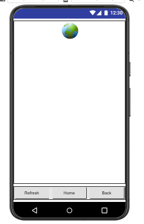
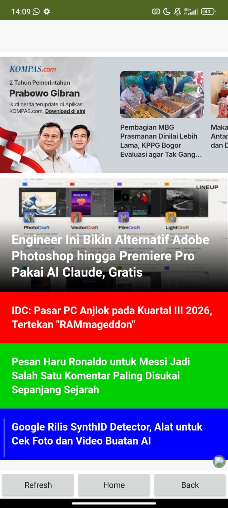

<div align="center">

# 📱 Prototype MIT App Inventor

[](https://appinventor.mit.edu/)
[]()
[]()

*Dokumentasi pengujian prototipe dan rilis file aplikasi yang dikembangkan menggunakan **MIT App Inventor**.*

</div>

---

## 📖 Tentang Repositori
Repositori ini berfungsi sebagai arsip prototipe aplikasi mobile yang dibuat dengan **MIT App Inventor**. Di dalamnya terdapat file instalasi/proyek aplikasi beserta dokumentasi visual (*screenshot*) hasil pengujian antarmuka (*designer*) di website maupun hasil running langsung pada perangkat mobile.

## 📂 Isi Repositori
Seluruh file disimpan langsung pada *root* direktori repositori ini:
- 📄 **File Aplikasi (`.apk` / `.aia`)** — File mentah proyek MIT App Inventor atau paket instalasi Android yang siap dijalankan.
- 🖼️ **Screenshot Pengujian Web** — Dokumentasi tampilan *Designer* & *Blocks* saat proses pengembangan di web MIT App Inventor.
- 📸 **Screenshot Pengujian Aplikasi** — Bukti tampilan antarmuka dan fungsionalitas saat aplikasi dijalankan di smartphone.

## 📋 Prasyarat Pembuatan
Sebelum mulai merancang, mengedit, atau menguji aplikasi di MIT App Inventor, pastikan kamu telah menyiapkan beberapa hal berikut:
* **Akun Google:** Diperlukan untuk masuk ke platform [MIT App Inventor](https://appinventor.mit.edu/).
* **Perangkat Pengujian:** Menggunakan *MIT AI2 Companion* yang diunduh ke HP Android melalui Play Store, atau menggunakan emulator bawaan di komputer.
* **Koneksi Internet:** Karena MIT App Inventor berjalan secara berbasis web (*cloud-based*).

## 📸 Galeri Pengujian

> 💡 *Tips: Ganti nama file gambar di bawah ini sesuai dengan nama file screenshot yang kamu upload ke repositori agar gambarnya langsung muncul di halaman depan GitHub!*

| Pembuatan Website (Designer / Blocks) | Pengujian di Perangkat (Mobile App) |
| :---: | :---: |
|  |  |

## 🚀 Cara Mencoba Aplikasi
1. **Jika menggunakan file `.apk`:**
   - Unduh file `.apk` yang tersedia di repositori ini langsung melalui perangkat Android.
   - Instal aplikasi (aktifkan izin *"Install from Unknown Sources"* jika diminta) dan jalankan.
2. **Jika menggunakan file `.aia`:**
   - Unduh file `.aia` dari repositori ini.
   - Buka [MIT App Inventor](https://appinventor.mit.edu/), pilih **Projects** > **Import project (.aia) from my computer**, lalu unggah file tersebut.

---

<div align="center">
Dibuat oleh <a href="https://github.com/jannfth">jannfth</a> menggunakan MIT App Inventor.
</div>

## 📂 Struktur Folder Proyek
Berikut adalah rancangan struktur direktori yang digunakan dalam proyek ini:
```text
Prototype-Mit-Inventor/
│
├── Test.png                 # Screenshot / preview tampilan aplikasi
├── assets/                  # Folder penyimpanan aset (gambar, ikon, atau media)
├── src/                     # Berkas sumber atau file proyek (.aia / source code)
├── .gitignore               # Berkas pengecualian Git
└── README.md                # Dokumentasi proyek
